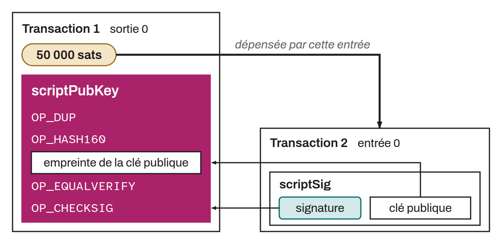

Script located in the output part of a Bitcoin transaction that defines the conditions under which the associated UTXO can be spent. This script thus secures bitcoin. In its most common form, the `scriptPubKey` contains a condition requiring the next transaction to provide proof of possession of the private key corresponding to a specified Bitcoin address. This is often done by a script that asks for a signature matching the public key associated with the address used to secure those funds. When a transaction tries to use this UTXO as an input, it must provide a `scriptSig` that, executed first and followed by the `scriptPubKey` on the same stack, satisfies the conditions and produces a valid script. For a native SegWit output, the `scriptSig` must be empty: the unlocking data is then in the witness.



For example, here is a classic P2PKH `scriptPubKey`:

```text
OP_DUP
OP_HASH160
OP_PUSHBYTES_20
<public key hash>
OP_EQUALVERIFY
OP_CHECKSIG
```

The corresponding `scriptSig` would be:

```text
<signature> <public key>
```

*This script is also sometimes called a “locking script”.*
