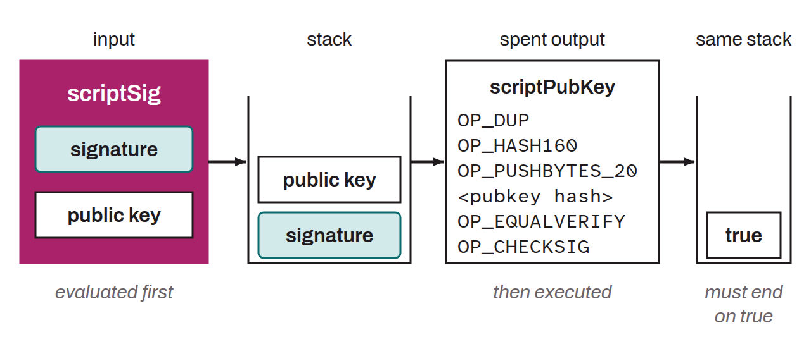

Element of a Bitcoin transaction located in the inputs. The `scriptSig` provides the data needed to satisfy the conditions set by the `scriptPubKey` of the previous transaction whose funds are being spent. It therefore plays a role complementary to the `scriptPubKey`. Typically, the `scriptSig` contains a digital signature and a public key. The signature is generated by the owner of the bitcoin using their private key and proves that they are authorized to spend the UTXO. In this case, the `scriptSig` demonstrates that the holder of the input owns the private key corresponding to the public key associated with the address specified in the `scriptPubKey` of the previous transaction's output.

When the transaction is validated, the node first executes the `scriptSig`, which pushes data onto the stack, then the corresponding `scriptPubKey` on that same stack. If the result is valid, the conditions for spending the funds have been met. If all the transaction's inputs provide a `scriptSig` that satisfies their `scriptPubKey`, the transaction is valid and can be added to a block for execution.

For example, here is a classic P2PKH `scriptSig`:

```text
<signature> <public key>
```

The corresponding `scriptPubKey` would be:

```text
OP_DUP
OP_HASH160
OP_PUSHBYTES_20
<public key hash>
OP_EQUALVERIFY
OP_CHECKSIG
```



*The `scriptSig` is also sometimes called the “unlocking script”.*
