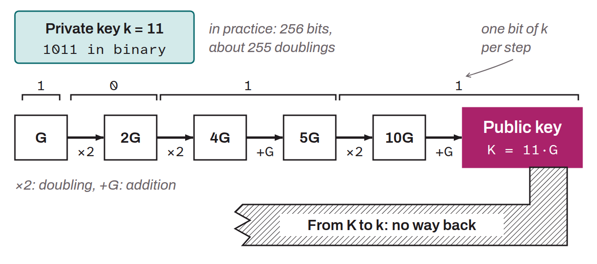

Name given to a specific elliptic curve used in the Bitcoin protocol to implement the ECDSA (*Elliptic Curve Digital Signature Algorithm*) and Schnorr digital signature algorithms. The `secp256k1` curve was chosen by Bitcoin's inventor, Satoshi Nakamoto. It has certain interesting properties, notably performance advantages.

Using `secp256k1` on Bitcoin means that each private key (a random 256-bit number) is mapped to a corresponding public key by multiplying the generator point of the `secp256k1` curve by the private key, a scalar multiplication carried out through a series of point additions and doublings. This operation is easy to perform in one direction but practically impossible to reverse, which is the basis of the security of digital signatures on Bitcoin.

The `secp256k1` curve is specified by the elliptic curve equation $y^2 = x^3 + 7$, meaning that it has coefficients $a$ equal to $0$ and $b$ equal to $7$ in the general form of an elliptic curve equation $y^2 = x^3 + ax + b$. `secp256k1` is defined over a finite field whose order is a very large prime number, specifically $p = 2^{256} - 2^{32} - 977$. The curve also has a group order, which is the number of distinct points on the curve, a predefined generator point (or point $G$), which is used in cryptographic operations to generate key pairs, and a cofactor equal to $1$.

*“SEC” stands for Standards for Efficient Cryptography. “P256” means that the curve is defined over a field $\mathbb{Z}_p$ where $p$ is a 256-bit prime number. “K” denotes a Koblitz curve, a family of curves named after the mathematician Neal Koblitz. Finally, “1” denotes that this is the first version of the curve.*
