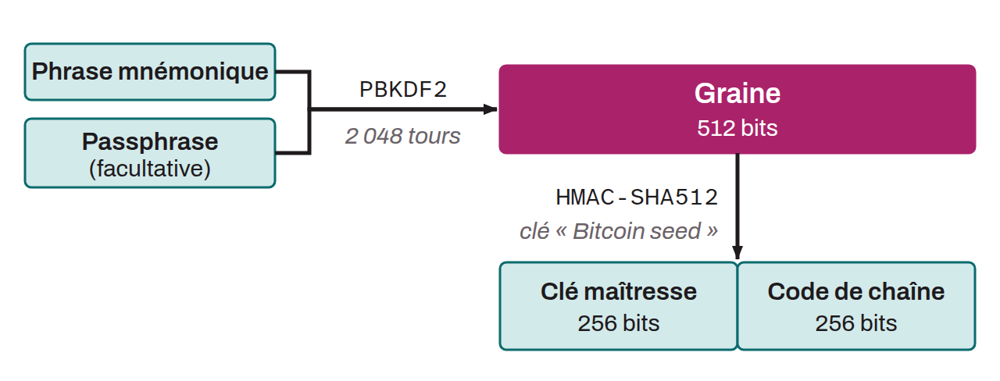

In the specific context of a Bitcoin hierarchical deterministic wallet, a 512-bit piece of information derived from randomness. It makes it possible to deterministically and hierarchically generate a set of private keys, and their corresponding public keys, for a Bitcoin wallet. The seed is often confused with the mnemonic phrase itself, yet they are different pieces of information. The seed is obtained by applying the `PBKDF2` function to the mnemonic phrase and the optional passphrase.

The seed was invented with BIP-0032, which defines the foundations of the hierarchical deterministic wallet. In this standard, the seed can be between 128 and 512 bits long (256 bits being recommended). This makes it possible to derive all of a wallet's keys from a single piece of information, unlike JBOK (Just a Bunch Of Keys) wallets, which require a new backup for every key generated. BIP-0039 later proposed an encoding of this seed, to make it easier for humans to read. The encoding takes the form of a sentence, usually called a mnemonic phrase. This standard helps avoid errors when backing up the seed, notably through the use of a checksum.

Outside the context of Bitcoin, in cryptography in general, a seed is an initial value used to generate cryptographic keys or, more broadly, any kind of data produced by a pseudorandom number generator. This initial value must be random and unpredictable to guarantee the security of the cryptographic system. The seed introduces entropy into the system, but the generation process that follows is deterministic.

*In everyday language, most bitcoiners use “seed” to refer to the mnemonic phrase, not to the intermediate derivation state between the mnemonic phrase and the master key.*
