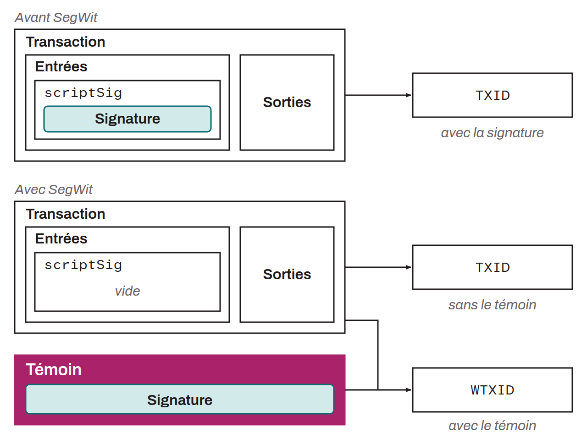

Acronym for *Segregated Witness*, a Bitcoin protocol upgrade introduced in August 2017. It aims to solve several technical problems, including the network's transaction capacity, transaction malleability, and the difficulty of making future protocol changes.

This soft fork changes the structure of transactions by moving signature data into a separate structure. In practice, with SegWit, signatures are removed from the traditional transaction structure and placed in a distinct data structure, the witness. The wtxids of all the transactions in the block form a separate Merkle tree, whose root is committed in the coinbase transaction, in an `OP_RETURN` output marked by the `aa21a9ed` header (BIP-0141). This separation increases the effective capacity of each block by replacing the old 1 MB limit with a new limit of 4 million weight units (4 MWU), while remaining backward compatible with old nodes. This change also solves the transaction malleability problem. Before SegWit, signatures could be modified before a transaction was confirmed, which changed the transaction's identifier. This made it hard to build complex transactions, because an unconfirmed transaction could see its identifier change. By separating signatures, SegWit makes transactions non-malleable, since any change to the signatures no longer affects the transaction ID (txid), only the witness transaction ID (wtxid). By solving the malleability problem, SegWit paved the way for other layer 2 developments on Bitcoin, notably the Lightning Network, which allows fast, low-cost transactions.

