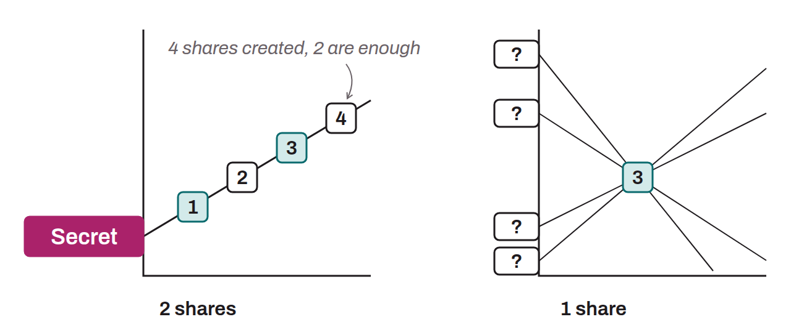

Cryptographic secret sharing scheme designed by Adi Shamir in 1979. It splits a secret into n distinct shares, such that a minimum of t shares is needed to reconstruct the original secret, while t-1 shares or fewer reveal no information about it. The (t, n) setting is defined when the shares are created.

In the Bitcoin ecosystem, Shamir's secret sharing is used in several contexts. The Codex32 protocol, formalized in BIP-0093, relies on this scheme to allow the manual backup and reconstruction of seeds. It is also an option offered on Trezor hardware wallets. Threshold signature protocols such as FROST also rely on this mechanism during the distributed key generation phase.
