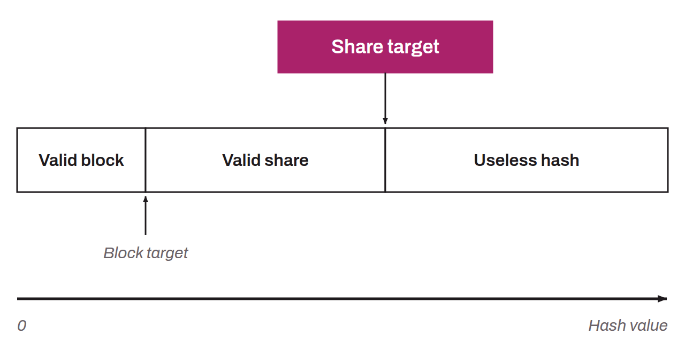

In mining pools, a share is a measure used to quantify the contribution of an individual miner within the pool. This measure is the basis for calculating the reward the pool redistributes to each miner. Each share corresponds to a hash that satisfies an easier difficulty target than the Bitcoin network's.

As an analogy, consider a 20-sided die. On Bitcoin, suppose proof of work requires a roll below 3 to validate a block (that is, a result of 1 or 2). Now imagine that within a mining pool, the difficulty target for a share is set at 10. For an individual miner in the pool, every roll that gives a result below 10 then counts as a valid share. The miner sends these shares to the pool to claim payment, even though they do not correspond to a valid result for a block on Bitcoin.

For each hash computed, an individual miner in a pool can run into three different scenarios:
* If the hash value is greater than or equal to the difficulty target the pool set for a share, the hash is of no use. The miner then changes their nonce to try a new hash: `hash > share > block`.
* If the hash is below the share difficulty target but greater than or equal to the Bitcoin difficulty target, it is a valid share that is not enough to validate a block. The miner can send this hash to their pool to claim the reward associated with the share: `share > hash > block`.
* If the hash is below the Bitcoin network's difficulty target, it counts both as a valid share and as a valid block. The miner sends this hash to their pool, which immediately broadcasts it to the Bitcoin network. The hash is also counted as a valid share for the miner: `share > block > hash`.

This share system is used to estimate the work done by each individual miner within a pool, without having to recompute every hash a miner generates, which would be completely inefficient for the pool.

Mining pools adjust the difficulty of shares to balance the verification load and make sure every miner, small or large, submits shares roughly every few seconds. This allows each miner's hashrate to be calculated precisely and rewards to be distributed according to the chosen payout method (PPS, PPLNS, TIDES...).
