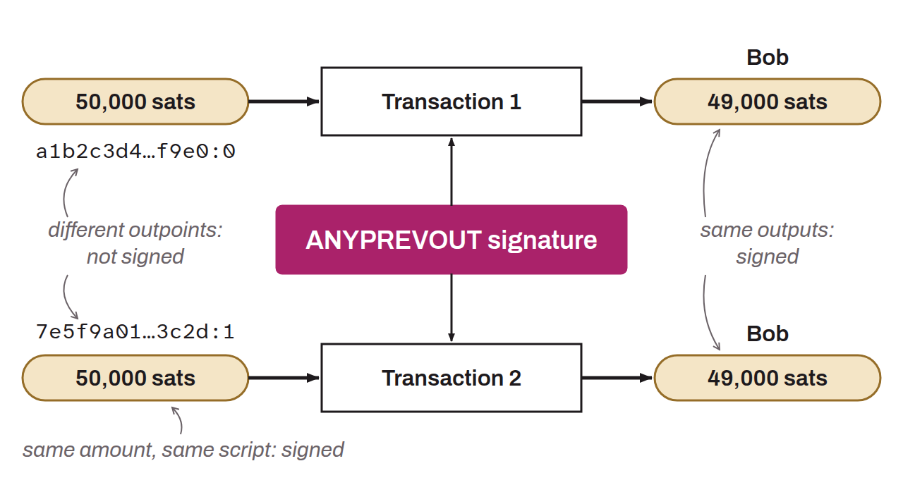

Proposal to implement a new modifier sighash flag in Bitcoin, introduced with BIP-0118. `SIGHASH_ANYPREVOUT` allows greater flexibility in transaction handling, particularly for advanced applications such as payment channels on the Lightning Network and the Eltoo upgrade. `SIGHASH_ANYPREVOUT` makes it possible to bind the signature to no specific earlier UTXO (*Any Previous Output*). Used in combination with `SIGHASH_ALL`, it would sign all outputs of a transaction, but only the input that carries the signature, without committing to the specific UTXO that this input spends. This would allow the signature to be reused for different transactions, as long as certain specified conditions are met.

*The `SIGHASH_ANYPREVOUT` modifier is inherited from the `SIGHASH_NOINPUT` idea already named in the Lightning Network white paper by Joseph Poon and Thaddeus Dryja (July 17, 2015 version).*
