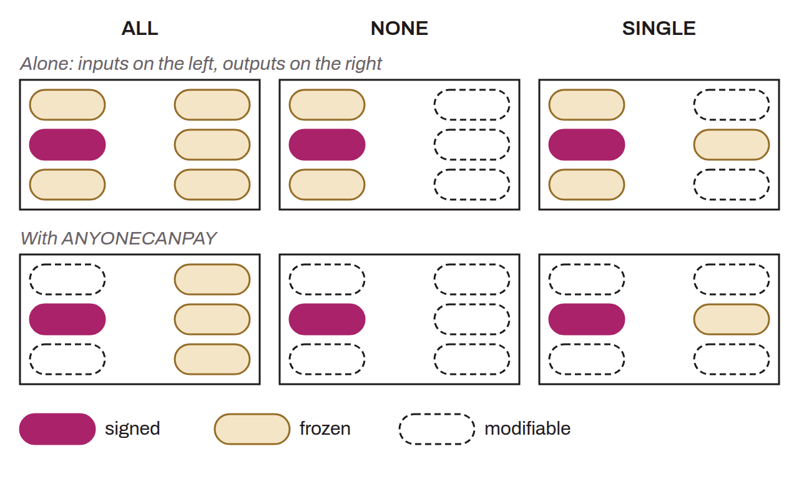

Parameter in a Bitcoin transaction that determines which components of the transaction (inputs and outputs) are covered by the associated signature, and therefore become immutable. The sighash flag is a byte appended to the digital signature of each input. The choice of sighash flag thus directly affects which parts of the transaction are frozen by the signature and which can still be modified afterward. This mechanism ensures that signatures commit to transaction data precisely and securely, according to the signer's intent. Three main sighash flags exist:

* `SIGHASH_ALL` (`0x01`): The signature applies to all inputs and outputs of the transaction, thus locking them completely;

* `SIGHASH_NONE` (`0x02`): The signature applies to all inputs, but to no output, allowing the outputs to be modified after signing;

* `SIGHASH_SINGLE` (`0x03`): The signature covers all inputs and only one output, the one matching the index of the signed input.

In addition to these three sighash flags, the `SIGHASH_ANYONECANPAY` modifier (`0x80`) can be combined with each of the previous types. When this modifier is used, only one input is signed, leaving the others open to modification. Here are the existing combinations with the modifier:

* `SIGHASH_ALL | SIGHASH_ANYONECANPAY` (`0x81`): The signature applies to a single input while covering all outputs of the transaction;

* `SIGHASH_NONE | SIGHASH_ANYONECANPAY` (`0x82`): The signature covers a single input, without committing to any output;

* `SIGHASH_SINGLE | SIGHASH_ANYONECANPAY` (`0x83`): The signature applies to a single input and only to the output with the same index as that input.

*A synonym sometimes used for “sighash” is “signature hash types”.*
