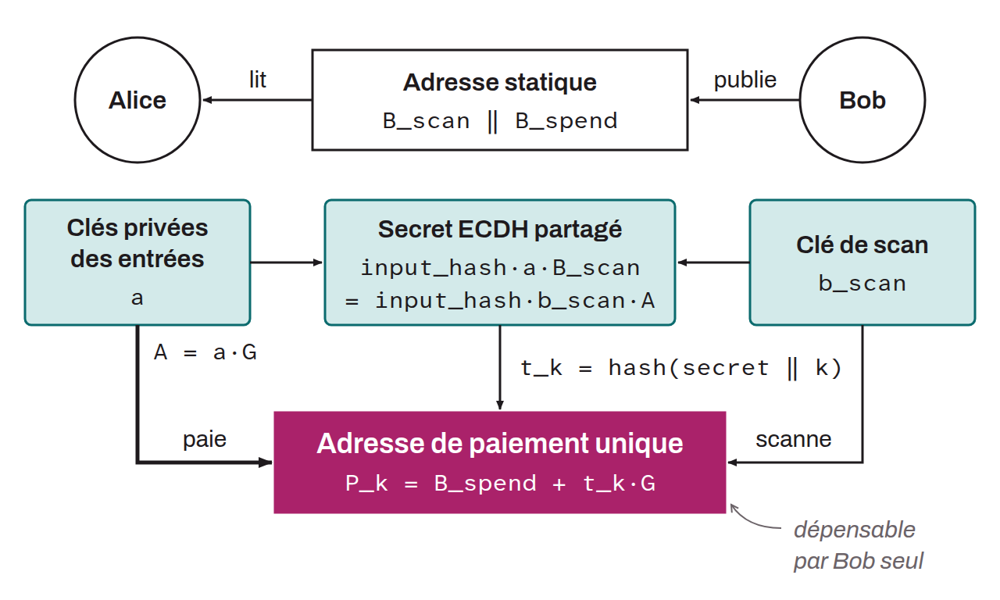

Method for using static Bitcoin addresses to receive payments without address reuse, without interaction, and without any visible on-chain link between the payments and the static address. This technique removes the need to generate a new, unused receiving address for each transaction, which avoids the interaction normally required in Bitcoin, where the recipient must give the payer a new address.

With Silent Payments, the payer uses the recipient's public keys (spend public key and scan public key) and the sum of the payer's own private keys for the inputs to generate a fresh address for each payment. Only the recipient, with their private keys, can compute the private key corresponding to this payment address. ECDH (Elliptic-Curve Diffie-Hellman), a cryptographic key exchange algorithm, establishes a shared secret, which is then used to derive the receiving address and the private key (on the recipient's side only). To identify the Silent Payments addressed to them, recipients must scan the blockchain and examine each transaction that meets the criteria of the protocol. Unlike BIP-0047, which uses a notification transaction to establish the payment channel, Silent Payments remove this step, which saves a transaction. The tradeoff, however, is that the recipient must scan all potential transactions to determine, by applying ECDH, whether each one is addressed to them.



For example, Bob's static address $B$ is the concatenation of his scan public key and his spend public key:
$$B\ =\ B_{scan}\ \Vert\ B_{spend}$$

These keys are derived from the following paths:

```text
scan : m / 352' / 0' / 0' / 1' / 0
spend : m / 352' / 0' / 0' / 0' / 0
```

Bob publishes this static address. Alice retrieves it to make a Silent Payment to Bob. She computes Bob's payment address $P_0$ as follows:
$$P_0\ =\ B_{spend}\ +\ hash(inputHash \cdot a \cdot B_{scan}\ \Vert\ 0) \cdot G$$

Where:
$$inputHash\ =\ hash(outpoint_L\ \Vert\ A)$$

With:
* $B_{scan}$: Bob's scan public key (static address);
* $B_{spend}$: Bob's spend public key (static address);
* $A$: the sum of the public keys of the eligible inputs (P2TR, P2WPKH, P2SH-P2WPKH, and P2PKH), that is, $a \cdot G$;
* $a$: the sum of the private keys of the eligible inputs of Alice's transaction, the other inputs being ignored;
* $outpoint_L$: the lexicographically smallest outpoint used as an input of Alice's transaction;
* $\Vert$: the concatenation (the operation of placing the operands end to end);
* $G$: the generator point of the `secp256k1` elliptic curve;
* $hash$: the tagged SHA256 hash function: tag `BIP0352/Inputs` for $inputHash$, `BIP0352/SharedSecret` for the computation of $P_0$;
* $P_0$: the first public key / unique address for the payment to Bob;
* $0$: an integer used to generate several unique payment addresses.

Bob scans the blockchain to find his Silent Payment as follows:
$$P_0\ =\ B_{spend}\ +\ hash(inputHash \cdot b_{scan} \cdot A\ \Vert\ 0) \cdot G$$

With:
* $b_{scan}$: Bob's scan private key.

If $P_0$ appears among the transaction's outputs, the transaction contains a Silent Payment addressed to him, and he computes $p_0$, the private key that can spend the funds Alice sent to $P_0$:
$$p_0\ =\ (b_{spend}\ +\ hash(inputHash \cdot b_{scan} \cdot A\ \Vert\ 0)) \mod n$$

With:
* $b_{spend}$: Bob's spend private key;
* $n$: the order of the `secp256k1` elliptic curve.

In addition to this basic version, labels can be used to generate several static addresses from a single base static address, to separate different uses without multiplying the scanning workload.
