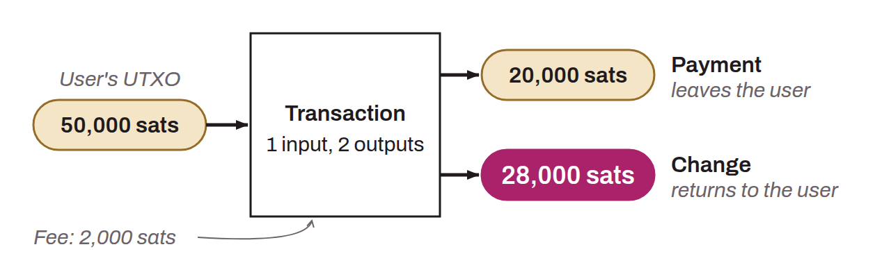

Transaction pattern (or model) used in chain analysis, characterized by the consumption of one or more UTXOs as inputs and the production of 2 UTXOs as outputs. This pattern looks like this:

The simple payment pattern indicates that the transaction is likely a send or a payment. The user consumed their own UTXO as an input to produce, as outputs, a payment UTXO and a change UTXO (change that returns to the same user). It can therefore be inferred that the observed user likely no longer holds one of the two output UTXOs (the payment one), but still holds the other (the change one).
