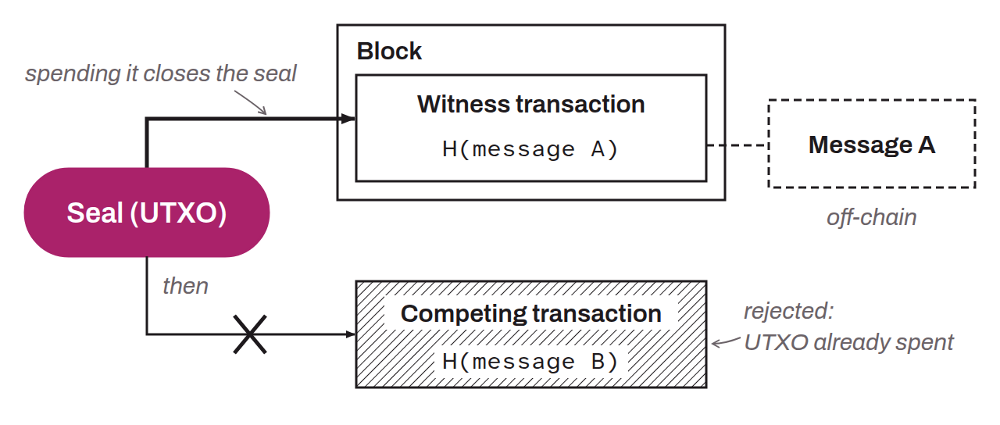

Formal promise to commit only once to a message not yet known, so that the fact of the commitment is demonstrably known to a defined audience as a whole. This mechanism aims to prevent the creation of multiple competing commitments for the same seal, which guarantees the uniqueness of each validation. By imposing this single-use constraint, the single-use seal is used on RGB to prevent double spending.

