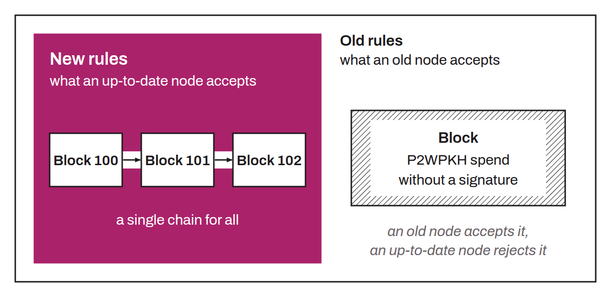

Backward-compatible change to the protocol rules. Unlike a hard fork, a soft fork does not split the network of Bitcoin nodes into two distinct groups, provided that a majority of the hash power is on the updated chain. If all goes well, nodes with the update and nodes without it therefore stay on the same blockchain. A change is backward-compatible when it adds or tightens certain protocol rules.

