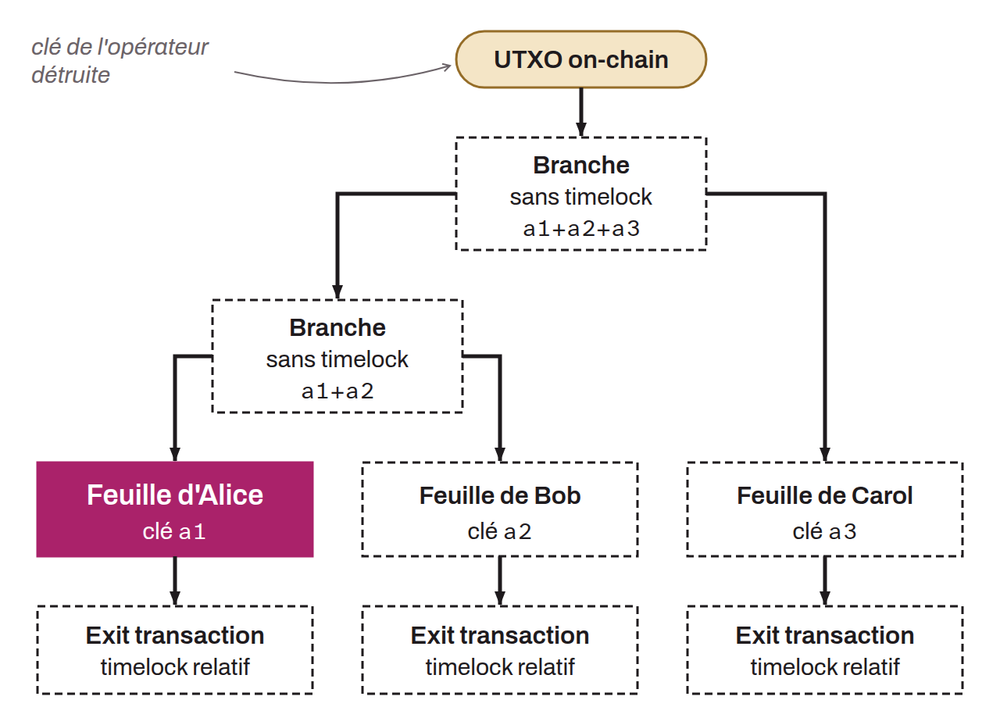

Off-chain tree structure used in the Spark protocol to split a single UTXO into several sub-units of value, in order to solve the problem of classic statechains, which required transferring an entire UTXO. The tree is made up of branches (branch transactions) and leaves (leaf transactions).

The root of the tree is the on-chain UTXO (`Txn0`), whose operator key is permanently destroyed. The branches are intermediate transactions kept off-chain, without a timelock, which can be spent only by aggregating the keys of all the leaves below them. The leaves are the terminal transactions held by individual users, each associated with an exit transaction with a relative timelock.

Splitting a leaf relies on a key additivity property: the parent key is split into several child keys whose sum equals the original key ($a_0 = a_1 + a_2 + \ldots + a_n$). This property also allows leaves to be re-aggregated.
