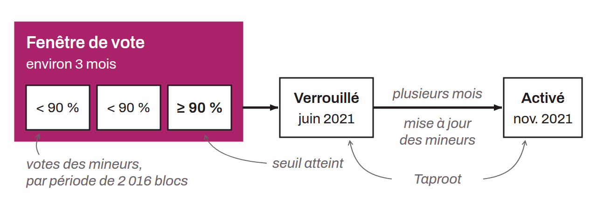

Soft fork activation mechanism first conceived for Taproot in early 2021 by David A. Harding, building on an idea from Russell O'Connor. Its principle is to use the BIP-0008 method with a `LOT` parameter set to `false`, while cutting the signaling period to about 3 months. This shorter voting window allows a quick check of miner approval. If the required approval threshold is reached during one of the periods, the soft fork is locked in. It activates several months later, giving miners the time they need to update their software.

The success of this method for Taproot, which enjoyed broad consensus in the Bitcoin community, does not guarantee that it will work for every upgrade, however. Although Speedy Trial allows faster activation, some developers have voiced concerns about its future use. They fear that it could lead to a succession of soft forks that is too rapid, which could threaten the stability and security of the Bitcoin protocol. Compared with BIP-0008 with `LOT=true`, Speedy Trial is much less threatening to miners. No UASF is automatically scheduled. For Taproot, its deployment is specified in BIP-0341 (a modified BIP-0009, with a 90% threshold and a minimum activation height `min_activation_height` of 709632). BIP-0343 describes it as effectively a BIP-0008 whose start and end bounds are expressed in median time past rather than in block height.

*“Speedy Trial” is borrowed from legal terminology, where it refers to a trial held without delay. It evokes the fact that the improvement proposal is brought quickly before the court of the miners, so that their intentions become known.*
