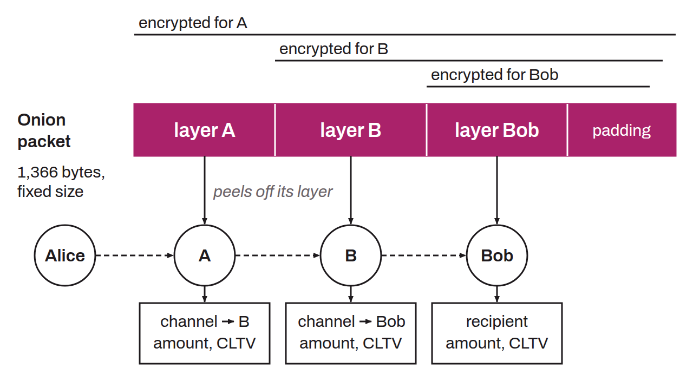

Cryptographic packet format used by the Lightning Network to route payments privately through onion routing. Originally designed by George Danezis and Ian Goldberg in 2009 for mix networks, it encapsulates routing instructions in successive layers of encryption. Each intermediate node can decrypt only the layer intended for it, revealing only the next hop, the amount to forward to it, and the CLTV of the outgoing HTLC (BOLT-04), without knowing the sender or the final recipient.

