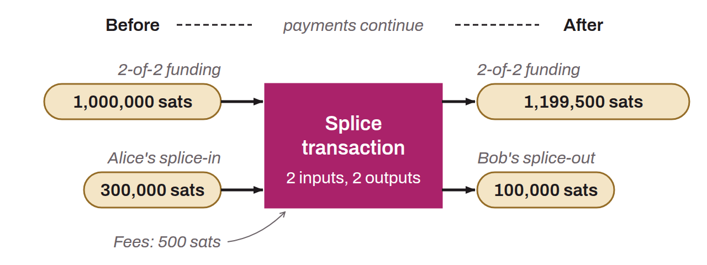

Lightning Network mechanism that lets a payment channel be resized without closing it, either by adding funds to it (splice-in) or by withdrawing funds to an on-chain output (splice-out). The channel remains fully operational throughout the operation.

Splicing creates a new 2-of-2 multisig transaction that spends the existing funding UTXO into a new UTXO with the adjusted capacity. The channel first enters a “quiescence” mode (STFU) to freeze its state, then the two parties negotiate the transaction through the interactive-tx protocol, in which each can add inputs and outputs. Third parties can also join their own operations to the same transaction, which lets on-chain fees be shared. During confirmation, the old and the new channel state coexist, so payments can keep being routed without interruption.

Splicing reduces the number of on-chain transactions needed to adjust a channel's capacity from two to one. It also makes possible single-balance wallets, which unify on-chain and Lightning funds into a single balance for the user.
