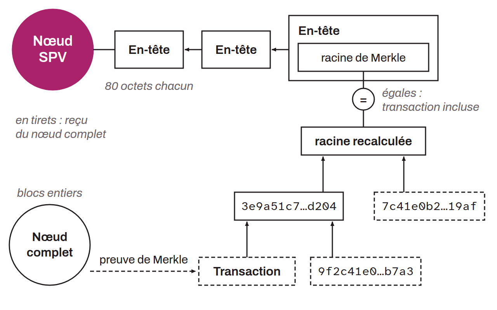

Light client of a Bitcoin node, known as an SPV (*Simplified Payment Verification*) node or sometimes a “light node”, that lets users verify the inclusion of a transaction in a block without having to store the entire blockchain. Instead, an SPV node stores only the block headers, and obtains information about specific transactions by querying full nodes when needed. This verification principle is made possible by the structure of transactions in Bitcoin blocks, which are organized within a cryptographic accumulator (Merkle tree).

This approach is advantageous for devices with limited resources, such as mobile phones. However, SPV nodes trust full nodes for the availability of information, which implies an additional level of trust and, consequently, lower security than full nodes. SPV nodes cannot validate transactions on their own, but they can verify whether a transaction is included in a block by checking Merkle proofs.
