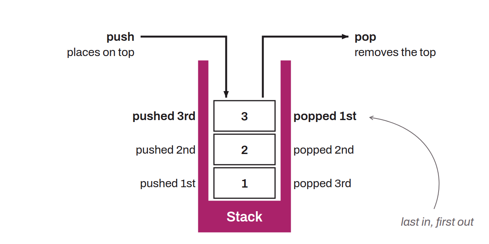

LIFO (Last In, First Out) data structure that stores temporary elements during script execution, in the language used to set spending conditions on Bitcoin UTXOs. Each operation in the script manipulates these stacks, where elements can be added (push) or removed (pop). Scripts use stacks to evaluate expressions, store temporary variables, and handle conditions.

During the execution of a Bitcoin script, two stacks can be used: the main stack and the alt stack (alternative). The main stack is used for most of a script's operations. It is on this stack that script operations add, remove, or manipulate data. The alt stack, for its part, is used to temporarily store data during script execution. Some specific opcodes, such as `OP_TOALTSTACK` and `OP_FROMALTSTACK`, move elements from the main stack to the alt stack and back.

For example, when a transaction is validated, signatures and public keys are pushed onto the main stack and processed by successive opcodes to verify that the signatures match the keys and the transaction data.
