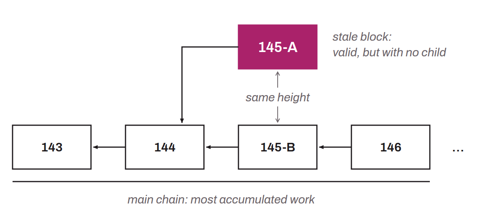

Block without a child: a valid block, but excluded from Bitcoin's main chain. It occurs when two miners each find a valid block at the same chain height within a short span of time and broadcast it on the network. Nodes eventually choose only one block to include in the chain, following the rule that the chain with the most accumulated work wins, which makes the other one “stale”. A stale block is produced as follows:
* Two miners find a valid block at the same chain height within a short time interval. These are called `Block A` and `Block B`;
* Each one broadcasts its block to the network of Bitcoin nodes. Each node now has two blocks at the same height. There are therefore two valid chains;
* Miners keep searching for proofs of work for the next blocks, but to do so, they must choose either `Block A` or `Block B` to mine on top of;
* A miner eventually finds a valid block on top of `Block B`. It is called `Block B+1`;
* It broadcasts `Block B+1` to the nodes of the network;
* Since nodes follow the chain with the most accumulated work, they conclude that `Chain B` is the one to follow;
* They abandon `Block A`, which is no longer part of the main chain. It has therefore become a stale block.

*Although I do not agree with this usage, some bitcoiners use the term “orphan block” to refer to what is in fact a stale block.*
