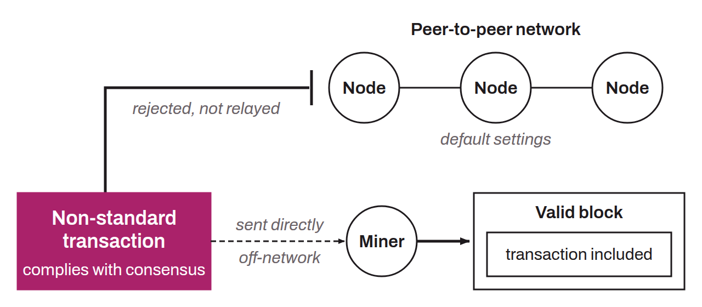

Subset of mempool policy, made up of the rules each Bitcoin node adopts individually, in addition to the consensus rules, to define the accepted format of unconfirmed transactions taken individually. More precisely, standardness rules dictate the structure of a transaction evaluated in isolation, independent of its context in the mempool. These rules are configured and enforced locally by each node and may vary from one node to another. They apply exclusively to unconfirmed transactions. Thus, a node will accept a transaction it would judge non-standard only if it is already included in a valid block.

Standardness rules exist mainly for three reasons:
* Protection against DoS attacks: some transactions are more expensive than others for the node to verify, and the asymmetry between the low cost of sending an unconfirmed transaction and the high cost of processing it creates a denial-of-service attack vector;
* Soft fork preparation mechanism: making a transaction type non-standard before making it invalid by consensus through a soft fork ensures that a non-upgraded miner will not include a newly invalid transaction in a block, which makes soft forks safer to deploy;
* Behavioral incentive: standardness rules can steer users toward practices that are less harmful to the network, or mildly discourage certain activities, such as the excessive storage of arbitrary data in the blockchain.

Note that most nodes keep the default settings as pre-established in Bitcoin Core, which effectively makes the standardness rules homogeneous across the network. A transaction that complies with the consensus rules but not with these standardness rules will have difficulty propagating on the network. It can nevertheless be included in a valid block if it ever reaches a miner. In practice, these transactions, described as “non-standard,” are often sent directly to a miner through channels outside Bitcoin's peer-to-peer network. This is often the only way to get this type of transaction confirmed.

For example, a transaction that allocates no fees at all is both valid under the consensus rules and non-standard, because Bitcoin Core's default policy for the `minRelayTxFee` parameter is `0.000001` (in BTC/kvB).

*Standardness rules are a subset of mempool policy, itself a subset of transaction relay policy, which is part of relay policy in the broad sense. Standardness rules should therefore not be confused with mempool policy, which is a more encompassing concept.*
