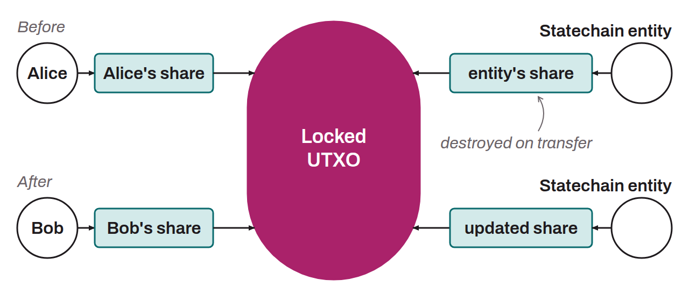

Layer 2 mechanism on Bitcoin that makes it possible to transfer ownership of a UTXO off-chain, without broadcasting an on-chain transaction. The concept was initially proposed by Ruben Somsen in 2018. It relies on a key shared between the user and an entity (the Statechain Entity). The UTXO stays locked on-chain by a single public key, whose private key is split into two shares, one held by the user and the other by the entity: nobody knows the complete key. Effective control changes hands by renewing the shares: when Alice transfers to Bob, the entity updates its share so that it combines with Bob's new share and yields the same key again, then deletes the old one. Alice's share becomes unusable.

Security rests on the assumption that the entity actually deletes its old key shares. To reduce this trust risk, the entity can be distributed among several operators through a threshold signature protocol: a single honest operator is enough to guarantee the integrity of the transfer. A unilateral exit mechanism lets the user recover funds on-chain if the entity disappears: at each transfer, the entity and the owner jointly sign a timelocked fallback transaction, whose delay shortens with each new owner. Statechains are used notably by the Spark protocol for instant transfers of bitcoin and other tokens.
