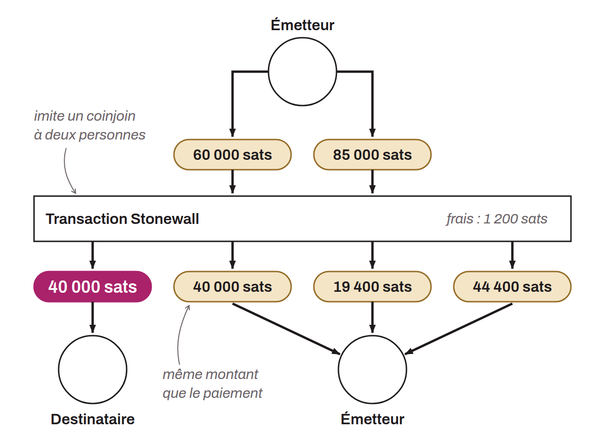

Specific form of Bitcoin transaction aimed at increasing users' privacy when spending by imitating a coinjoin between two people, without actually being one. This transaction is not collaborative. A user can build it alone, involving only UTXOs they own as inputs. It is therefore possible to create a Stonewall transaction for any occasion, without having to synchronize with another user.

A Stonewall transaction works as follows: as inputs, the sender uses at least 2 UTXOs they own, split into two groups. As outputs, the transaction produces 4 outputs, 2 of which are exactly the same amount. The other 2 are change. If this change is too small (below the dust threshold), it is given up to fees and only the 2 outputs of the same amount remain. Of the 2 outputs of the same amount, only one actually goes to the payment recipient.

There are therefore only 2 roles in a Stonewall transaction:
* The sender, who makes the actual payment;
* The recipient, who may be unaware of the specific nature of the transaction and simply expects a payment from the sender.

Stonewall transactions were proposed by the Samourai Wallet application, which shut down on April 24, 2024, and they are still proposed in 2026 by the Sparrow Wallet software.

The Stonewall structure adds a great deal of entropy to the transaction and muddies the trail for chain analysis. Seen from the outside, such a transaction can be read as a small coinjoin between two people. In reality, however, just like the Stonewall x2 transaction, it is a payment. This method therefore creates uncertainty in chain analysis, and even points toward false leads. Even if an outside observer manages to identify the Stonewall transaction pattern, they will not have all the information. They will not be able to determine which of the two UTXOs of equal amounts corresponds to the payment. Moreover, they will not be able to determine whether the two input UTXOs come from two different people or belong to a single person who merged them. This last point is due to the fact that Stonewall x2 transactions follow exactly the same pattern as Stonewall transactions. From the outside, and without additional information about the context, it is impossible to tell a Stonewall transaction from a Stonewall x2 transaction. Yet the former are not collaborative transactions, whereas the latter are. This adds even more doubt about this spend.
