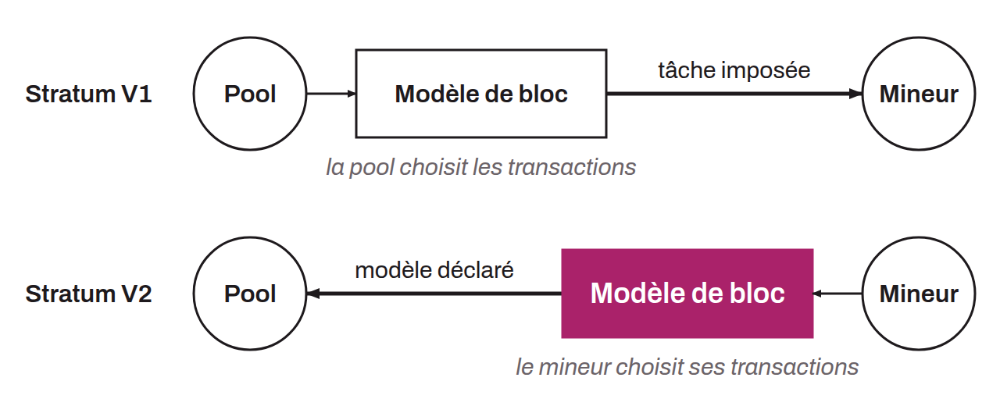

Evolution of Stratum, the well-known network protocol layered on top of Bitcoin and designed for mining. This type of protocol is designed to optimize communication between individual miners and mining pool servers in order to increase their profitability. Specified by Pavel Moravec and Jan Čapek of the Braiins pool (formerly "Slush Pool"), together with Matt Corallo, Stratum V2 introduces several improvements, notably more efficient communication between miners and mining pools, which reduces the bandwidth required. It also reduces pools' infrastructure needs. On the security side, it adds cryptographic authentication to prevent various man-in-the-middle attacks, in particular eavesdropping and malicious hashrate redirection. An important aspect of Stratum V2 is that it includes subprotocols that let individual miners choose their own sets of transactions to include in the blocks they work on. This feature gives more power to individual miners, unlike the original protocol, where pools had full control over the block template. This approach would thus strengthen the decentralization of the mining process in pools.

