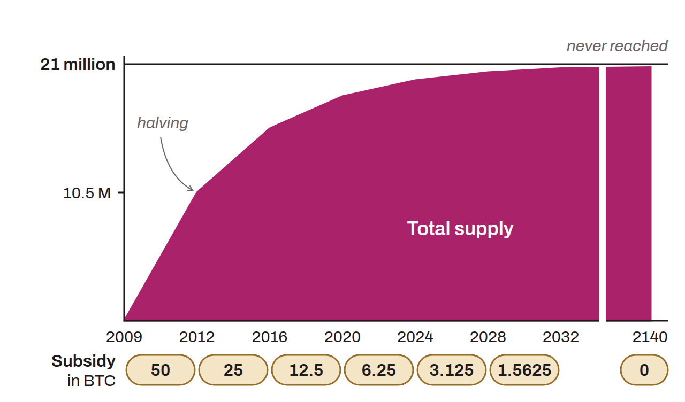

Ceiling set on the total supply of BTC, fixed at about 21 million units. This limit is defined by the inflation schedule in the Bitcoin protocol. New BTC are created and distributed to miners through the subsidy for validating each block. This subsidy is cut in half every 210,000 blocks, a process known as “halving”. This method guarantees that money creation will gradually decrease until it reaches zero.

