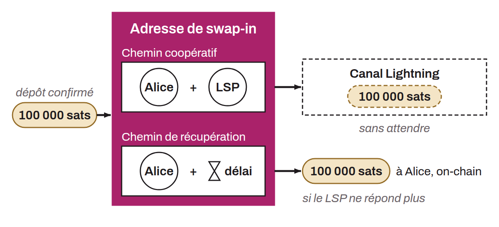

Protocol that makes it possible to move on-chain bitcoin to the Lightning Network almost instantly, without relying on 0-conf channels. Proposed by Jesse Posner and ZmnSCPxj in 2023, it relies on an on-chain address shared between the user (Alice) and an LSP (Bob).

This address encodes two spending paths: a cooperative path, in which Alice and Bob jointly sign to move the funds, and a unilateral recovery path, in which Alice can take her bitcoin back after a timelock expires. When funds are received and confirmed on this address, Alice can, with the LSP's help, immediately move them into an existing or new Lightning channel through the cooperative path. If the LSP is unavailable, Alice can still recover her funds on-chain after the set delay.

The main advantage of swap-in potentiam is that it reduces trust requirements compared with other methods of instantly opening channels. The temporary co-ownership of the funds and the safety timelock guarantee that neither Alice nor the LSP can steal the funds. ACINQ's Phoenix wallet uses a variant of this protocol called “Swaproot”, adapted to the constraints of mobile devices with intermittent connectivity.
