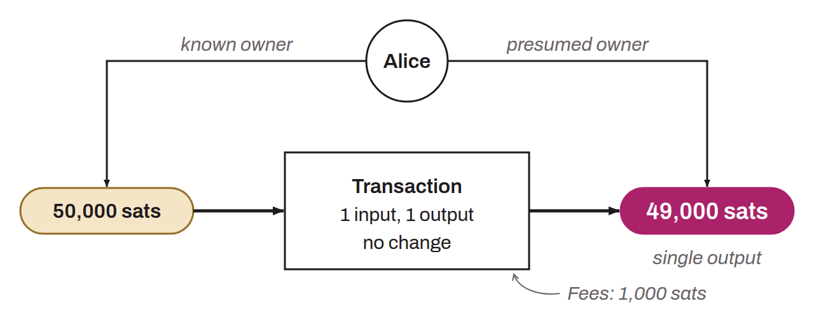

Transaction pattern used in chain analysis to determine the nature of a transaction. This pattern is characterized by consuming a single UTXO as input and producing a single UTXO as output. The interpretation of this pattern is that the transaction is a self-transfer. The user has transferred their bitcoin to themselves, to another address they own. Since the transaction has no change, it is very unlikely to be a payment. Indeed, when a payment is made, it is almost impossible for the payer to hold a UTXO that exactly matches the amount required by the seller, plus the transaction fees. The payer is therefore generally forced to produce a change output. It is then known that the observed user probably still holds this UTXO. In chain analysis, if the UTXO used as the transaction's input is known to belong to Alice, the output UTXO can be assumed to belong to her as well.

