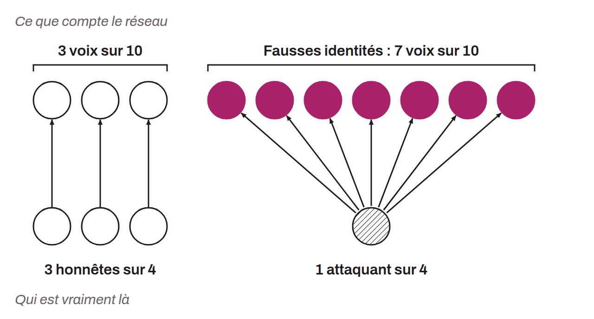

Computer attack in which an individual or entity creates multiple fake identities in a system to exert undue influence or gain an unauthorized advantage. In the context of Bitcoin, such an attack aims to gain undue influence over the system, thereby making it possible to manipulate the consensus mechanisms. To counter Sybil attacks, Satoshi Nakamoto devised a proof-of-work system that imposes a non-negligible marginal cost on creating multiple votes.

