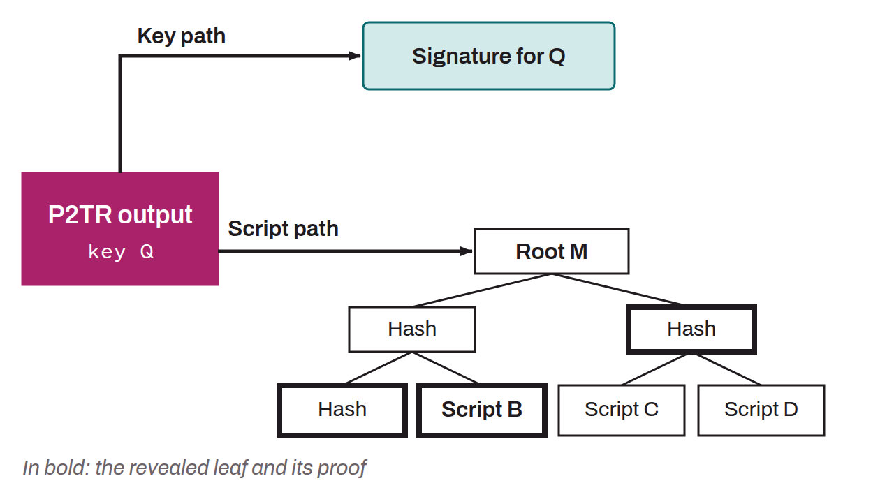

Major upgrade to the Bitcoin protocol, adopted through a soft fork in November 2021. It brings significant improvements in privacy, efficiency, and flexibility by implementing BIP-0340, BIP-0341, and BIP-0342. The upgrade locked in at block 687,284 on June 12, 2021, when 90% of the blocks mined during a period signaled support, showing that miners were ready to activate it (Speedy Trial). Activation finally took place at block 709,632 on November 14, 2021, almost four years after the first discussions on the subject among Pieter Wuille, Andrew Poelstra, and Gregory Maxwell. It was the first attempt at a major upgrade since the thorny activation of SegWit in 2017.

Taproot is also the name of BIP-0341, implemented within the soft fork of the same name, which introduces a new script template called P2TR. A P2TR script locks bitcoin to a single Schnorr public key, called $K$. However, this key $K$ is an aggregate of a public key $P$ and a public key $M$, the latter being a point obtained by hashing $P$ with the Merkle root of a tree whose leaves are scripts (tapscripts). Bitcoin locked with a P2TR script can be spent in two distinct ways: either by publishing a signature for the public key $K$, or by satisfying one of the scripts contained in the Merkle tree. The first option is called the “key path” and the second the “script path”.

