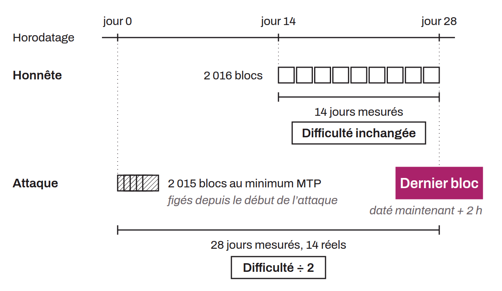

Theoretical attack on Bitcoin's difficulty adjustment mechanism that exploits a flaw in how block timestamps are verified at the boundary between two retarget periods. Every 2,016 blocks, the protocol recalculates the difficulty target by comparing the timestamp of the first block of the period with that of the last. The attack consists, for a miner who controls a majority of the computing power, in manipulating these timestamps: the miner sets the timestamps of almost all the blocks in the period to the minimum allowed by the median time past (MTP) rule, then gives the last block a timestamp in the future that complies with the limit of the node's system time + 2 hours (NAT + 2 hours before Bitcoin Core 27.0). The protocol then concludes that the period lasted much longer than it actually did, which causes an artificial and unjustified reduction in difficulty for the following period.

By repeating this process over several successive periods, an attacker could theoretically lower the difficulty until blocks are produced at an extreme rate (up to a maximum of 6 blocks per second). This extreme slowdown followed by acceleration would compromise the security of funds protected by timelocks, could saturate the bandwidth of the network's nodes, would make certain types of attacks such as eclipse attacks easier, and would cause numerous major reorganizations that make transaction confirmations unreliable. For the attacker, the main benefit is collecting block subsidies much faster than normal.

The “Consensus Cleanup” soft fork proposal (BIP-0054) aims to fix this vulnerability by requiring that the first block of a new difficulty period carry a timestamp that does not precede that of the last block of the previous period by more than 2 hours. This constraint prevents extreme manipulation of the time gaps between two retarget periods and therefore prevents this attack.

Note that this attack is made possible by a historical off-by-one bug introduced by Satoshi Nakamoto in the difficulty adjustment calculation. The calculation takes a duration of 2 weeks as its basis (supposed to correspond to $2016 \times 10$ minutes) and compares it to the difference between the first and the last block of the period, in order to determine a deviation. The problem is that between the first and the last block of a period there are actually only 2,015 intervals, not 2,016. For the calculation to be correct, it should have compared against the difference between the last block of the previous period and the last block of the current period that has just ended, which would have given exactly 2,016 intervals. Besides slightly biasing the adjustment calculation by about 0.05%, this bug is above all what makes time warp attacks possible. Indeed, if the comparison used the last block of the previous period rather than the first block of the period that has just ended, the periods would overlap, which would prevent this type of manipulation. The problem is that actually fixing this historical bug would require a hard fork.
