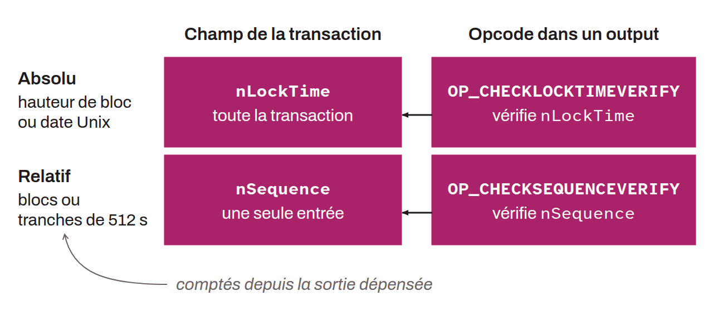

Smart contract primitive that sets a time condition a transaction must meet before it can be added to a block. There are two types of timelocks on Bitcoin:
* The absolute timelock, which specifies a precise moment before which the transaction cannot be included in a block;
* The relative timelock, which defines a delay counted from the confirmation of the output that the transaction spends.

The absolute timelock can be set either as a date expressed in Unix time or as a block number. The relative timelock is counted either in blocks or in units of 512 seconds. Finally, a timelock can apply to a transaction output through a specific opcode in the locking script (`OP_CHECKLOCKTIMEVERIFY` or `OP_CHECKSEQUENCEVERIFY`), to an entire transaction through the `nLockTime` field, or to a specific input through the `nSequence` field.

*A timelock is sometimes also called a "locktime".*
