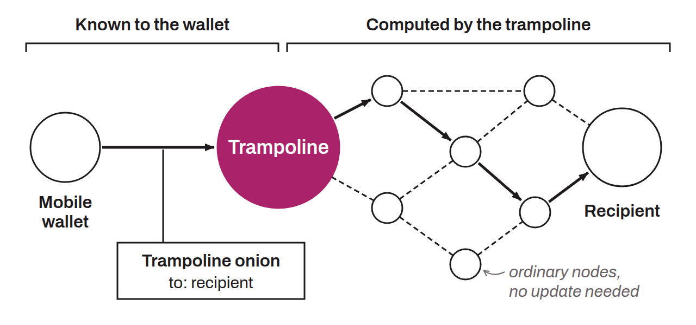

Lightning routing method that lets a light node delegate the construction of the payment path to one or more specialized intermediate nodes called trampoline nodes. It is particularly useful for embedded mobile nodes that cannot sync the full network graph because of constraints on storage, computing power, or intermittent connectivity.

The sender builds a “trampoline onion” that identifies the trampoline nodes by their full identifier. It routes the payment to the first trampoline, which itself calculates the route to the next trampoline or to the recipient. Non-trampoline nodes along the route need no update: they relay HTLCs like ordinary payments. To preserve privacy, the sender can chain at least two trampoline nodes, so that none of them knows whether it is routing to the final recipient or to another trampoline. Trampoline nodes charge an additional fee for this pathfinding service. Trampoline routing can be combined with blinded paths to hide the identity of the recipient, offering full privacy even from a mobile device.

