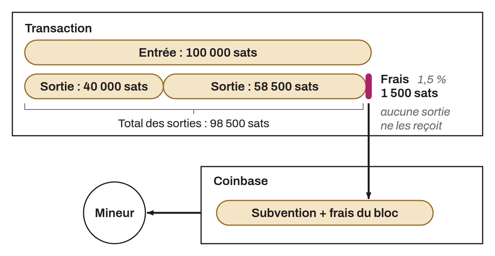

Sum that rewards miners for their participation in the proof-of-work mechanism. Transaction fees give miners an incentive to include transactions in the blocks they create. They are the difference between the total amount of a transaction's inputs and the total amount of its outputs:

```text
fees = inputs - outputs
```

Fees are expressed in `sats`, and the fee rate in `sat/vB`: they do not depend on the amount of bitcoin sent, but on the weight of the transaction. The sender of a transaction chooses them freely, and they determine how quickly it is included in a block through an auction mechanism. Take, for example, a transaction with one input of `100,000 sats`, one output of `40,000 sats`, and one output of `58,500 sats`. The outputs total `98,500 sats`, so the fees allocated to this transaction are `1,500 sats`. The miner who includes the transaction can create `1,500 sats` in its coinbase transaction, in exchange for the `1,500 sats` that the sender did not take back in the outputs.



Transactions with higher fees, relative to their size, are processed first by miners, which can speed up confirmation. Conversely, transactions with lower fees can be delayed during periods of heavy congestion. Transaction fees are distinct from the block subsidy, which is an additional incentive for miners. The block reward is made up of the new bitcoin created with each mined block (the block subsidy) plus the transaction fees collected. While the block subsidy shrinks over time because of the cap on the total supply of bitcoin, transaction fees will keep encouraging miners to participate.

At the protocol level, nothing prevents users from including transactions with no fees in a block. In practice, such fee-free transactions are the exception. By default, Bitcoin nodes do not relay transactions whose fee rate is below the relay threshold: `1 sat/vB` up to Bitcoin Core 29.0, then `0.1 sat/vB` since Bitcoin Core 29.1 and 30.0. Since Bitcoin Core 29.0, there is one exception: a zero-fee transaction that creates a single dust output (ephemeral dust) is accepted if a child spending that output accompanies the transaction and pays the fees for the whole package. When some fee-free transactions have made it through, it is because the winning miner included them directly, without them traveling through the node network. For example, the following transaction includes no fees:

```text
fd456524104a6674693c29946543f8a0befccce5a352bda55ec8559fc630f5f3
```

In this particular case, the transaction was initiated by the head of the F2Pool mining pool. For an ordinary user, the lower limit is therefore `0.1 sat/vB` by default since Bitcoin Core 29.1.

Eviction limits also have to be taken into account. During periods of heavy congestion, nodes' mempools evict their pending transactions below a certain threshold, to stay within their allocated RAM limit. Users are free to choose this limit, but many keep the Bitcoin Core default of 300 MB. It can be changed in the `bitcoin.conf` file with the `maxmempool` parameter.
