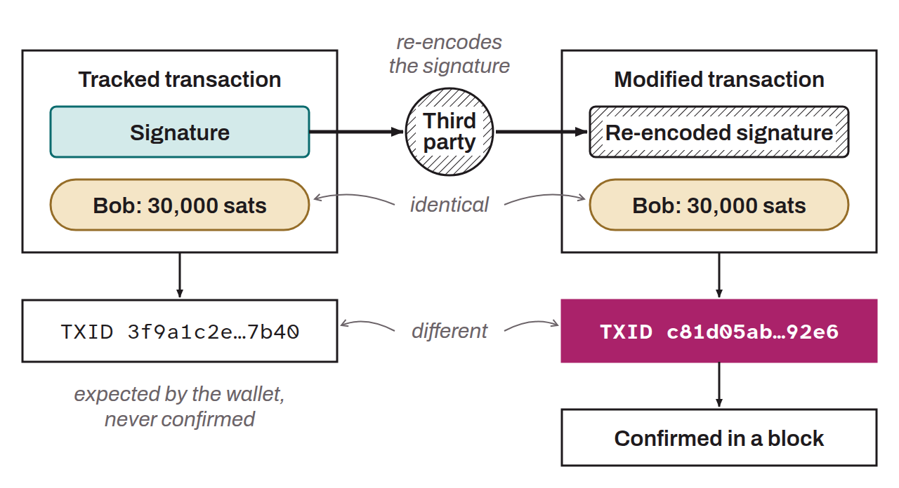

Possibility of slightly modifying the structure of a Bitcoin transaction without altering its effect, while changing its transaction ID (txid). This property can be exploited maliciously to mislead parties about the status of a transaction: the txid tracked by an exchange or a wallet may never appear in a block, while a modified version of the same transaction is confirmed there. Malleability was made possible by the flexibility of the digital signature and of the `scriptSig` (BIP-0062). It notably made implementing the Lightning Network complicated. The SegWit soft fork was introduced to solve this problem, by excluding the transaction's malleable data from the txid computation.

