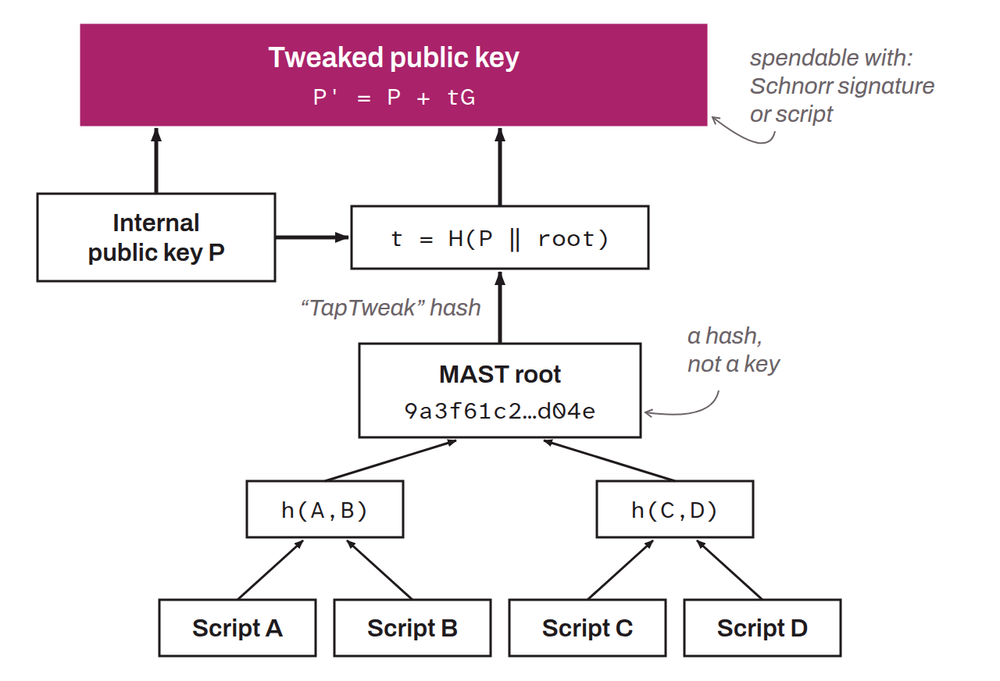

In cryptography, to “tweak” a public key means to modify it using an additive value, called the “tweak”, so that it remains usable with knowledge of the original private key and of the tweak. Technically, a tweak is a scalar value $t$ whose corresponding point $tG$ is added to the initial public key. If $P$ is the public key and $t$ is the tweak, the tweaked public key becomes:
$$
P' = P + tG
$$

Where $G$ is the generator of the elliptic curve used. This operation yields a new public key derived from the original key while keeping certain cryptographic properties that make it usable. For example, this method is used for Taproot (P2TR) addresses so that an output can be spent either by presenting a Schnorr signature in the traditional way, or by fulfilling one of the conditions set out in a Merkle tree, also called a “MAST”. An output without a script tree is also tweaked, with $t$ calculated from the key $P$ alone, so that no hidden script path is possible.

