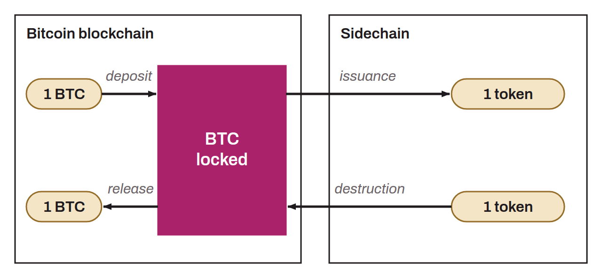

Mechanism that establishes a connection between Bitcoin's main system and a sidechain (or a drivechain). A two-way peg ensures a fixed value correlation between the bitcoin on the main blockchain and the corresponding assets on the sidechain, which makes it possible to move bitcoin between the two chains. To do so, the bitcoin is temporarily locked on the main blockchain and an equivalent amount of assets is issued on the sidechain. This makes it possible to benefit from the specific advantages of the sidechain, such as faster transactions or improved privacy features, while maintaining the value of the bitcoin used. When users want to return to the Bitcoin blockchain, the process is reversed: the assets on the sidechain are destroyed and the corresponding bitcoin is unlocked. Many different two-way peg mechanisms exist, and they can rely on:
* A single trusted third party;
* A federation of entities;
* The miners of the main chain (drivechain).

