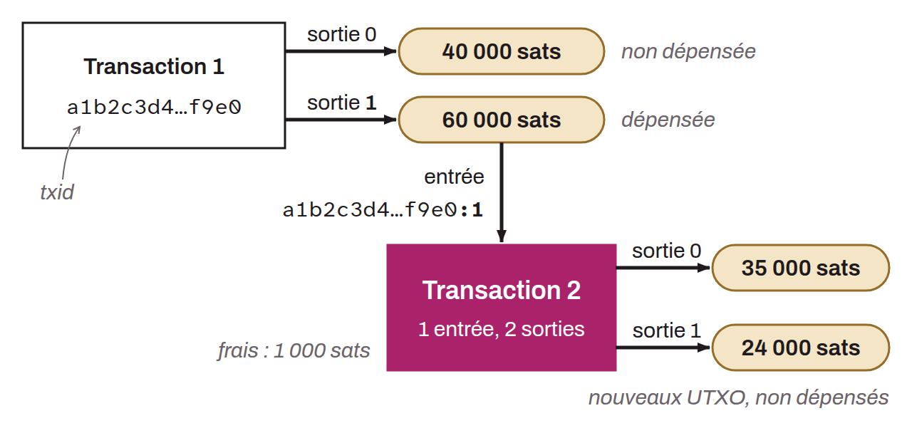

In the context of Bitcoin, operation recorded on the blockchain (abbreviated “TX”) that transfers ownership of bitcoin from one or more inputs to one or more outputs. Every transaction, except the coinbase transaction that creates the new bitcoin of the block, consumes UTXOs as inputs, which are outputs of previous transactions, and creates new UTXOs as outputs, which can be used as inputs in future transactions.

Each input includes a reference to an existing output as well as an unlocking script (`scriptSig`) that satisfies the spending conditions (the locking script, `scriptPubKey`) set by the output it references. This is what unlocks the bitcoin. For a SegWit output, the `scriptSig` is empty and this data is found in the witness. Outputs define new spending conditions (`scriptPubKey`) for the transferred bitcoin, often in the form of a public key or an address with which the bitcoin is now associated.
