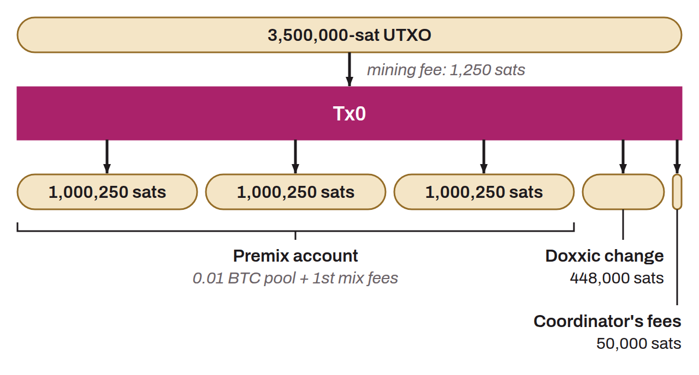

Preparatory transaction specific to the Whirlpool protocol, which is the first step before the coinjoin cycles. The Tx0 takes one or more UTXOs from the user's wallet and restructures them into several outputs calibrated to match exactly the amounts of the chosen coinjoin pool, in addition to mining fees for the first cycle.

In practice, the Tx0 produces several types of outputs: fixed-amount UTXOs intended to enter the coinjoin cycles (which go to the premix account), an output for the coordinator's fees, and possibly a change output (the “doxxic change”) that corresponds to the surplus that cannot be included in the pool.

