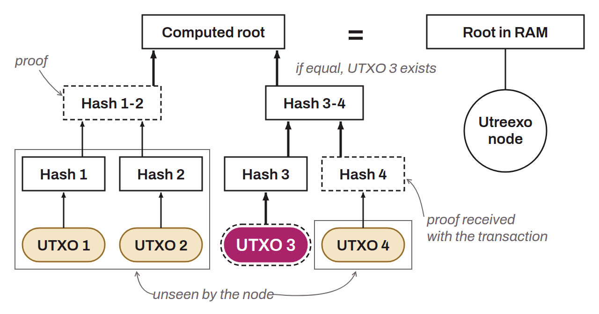

Protocol designed by Tadge Dryja to compact the UTXO set of Bitcoin nodes using an accumulator based on Merkle trees. Unlike the classic UTXO set, which requires significant storage space, Utreexo drastically reduces the memory required by storing, on a compact node, only the roots of the Merkle trees. This lets the node verify the existence of the UTXOs used as transaction inputs without having to keep the complete set of UTXOs. With Utreexo, a compact node keeps only cryptographic hashes called Merkle roots. When a transaction is broadcast, it is accompanied by inclusion proofs for its UTXOs and the corresponding Merkle paths, added by bridge nodes. The node can thus verify transactions without storing the whole UTXO set. Let's take an example with a diagram to understand this mechanism:

In this example, the UTXO set has been deliberately reduced to 4 UTXOs to make it easier to understand. In reality, Bitcoin has about 166 million UTXOs (figure as of October 26, 2026). In this diagram, the compact Utreexo node would only have to keep the Merkle root in RAM. If it receives a transaction spending UTXO 3 (the filled pill), the proof would consist of the following elements:
* UTXO 3;
* HASH 4;
* HASH 1-2.

Thanks to this information transmitted with the transaction, the Utreexo node performs the following checks:
* It hashes UTXO 3, which gives HASH 3;
* It concatenates HASH 3 with HASH 4;
* It hashes the concatenation, which gives HASH 3-4;
* It concatenates HASH 3-4 with HASH 1-2;
* It hashes the concatenation, which gives the Merkle root.

If the Merkle root it obtains through this process is the same as the Merkle root it stored in its RAM, then it concludes that UTXO 3 is indeed part of the UTXO set.

This method reduces the RAM requirements for full node operators. However, Utreexo has limits, notably the increase in the data to transmit to Utreexo nodes because of the additional proofs (the block size in the consensus sense does not change) and the potential dependence of Utreexo nodes on bridge nodes to obtain missing proofs. Bridge nodes keep the complete forest of UTXOs and add the proofs to transactions, and archival nodes serve those of old blocks. An ordinary full node does not produce these proofs, which lets compact Utreexo nodes perform a full verification. This approach offers a tradeoff between efficiency and decentralization, making transaction validation more accessible to users with limited resources.
