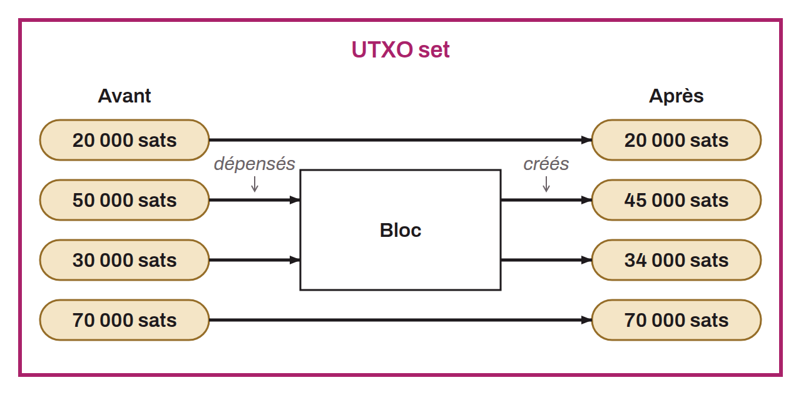

Set of all the UTXOs that exist at a given moment. In other words, a big list of all the different pieces of bitcoin waiting to be spent. Adding up the amounts of all the UTXOs in the UTXO set gives the total money supply of bitcoin in circulation. Each node of the Bitcoin network maintains its own UTXO set in real time. It updates the set as new valid blocks are confirmed, with the transactions they include, which consume some UTXOs from the UTXO set and create new ones in return.

Each node keeps this UTXO set to be able to quickly check that the UTXOs spent in transactions are legitimate. This lets nodes detect and reject double spend attempts. The UTXO set is often at the heart of concerns about the decentralization of Bitcoin, because its size naturally grows very fast. Since part of it must be kept in RAM to verify transactions in a reasonable time, the UTXO set could gradually make running a full node too costly. The UTXO set also has a strong impact on the initial block download (IBD). The more of the UTXO set can be held in RAM, the faster the IBD. In Bitcoin Core, the UTXO set is stored in the directory named `/chainstate`.
