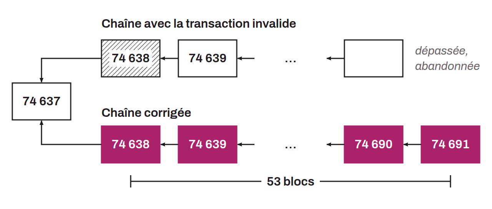

Bug exploited on August 15, 2010 on the Bitcoin network, which led to the creation of more than 184 billion bitcoin in a single transaction. The attacker exploited an integer overflow vulnerability in the verification of amounts: two outputs of 92,233,720,368.54 BTC each, close to the maximum value a signed 64-bit integer can represent, caused an overflow during the addition. The sum of the outputs became negative (about -0.00997538 BTC) and therefore passed the check requiring outputs less than or equal to inputs.

The problem was quickly spotted by Jeff Garzik, who alerted the community on the BitcoinTalk forum. Satoshi Nakamoto published a fix within hours. The fix added an explicit check of each output amount and of their sum, and rejected any transaction containing negative or excessive values. Miners then adopted the new version of the software and produced an alternative chain that excluded the invalid transaction.

The corrected chain overtook the chain containing the bug at block 74,691, after about 53 blocks of disruption. This episode, recorded as CVE-2010-5139, was the first major incident in Bitcoin's history.

