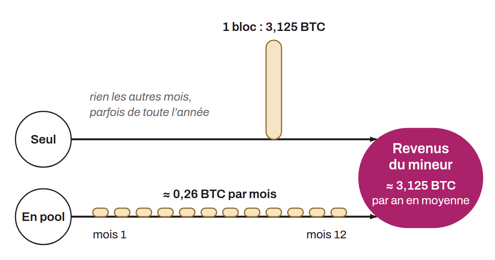

In mining, fluctuation of a miner's income due to the probabilistic nature of the search for valid blocks. Even with constant computing power, the time needed to find a block can vary considerably. As a result, miners can go through long periods without receiving any rewards, followed by periods of large gains.

Mining pools are designed to reduce this variance. By pooling the computing power of many individual hashers, pools increase the frequency at which blocks are found, which allows a more regular and predictable distribution of rewards. The variance is then said to be reduced.

Variance is an inherent flaw of Bitcoin's proof-of-work mechanism that pushes mining toward pooling.
