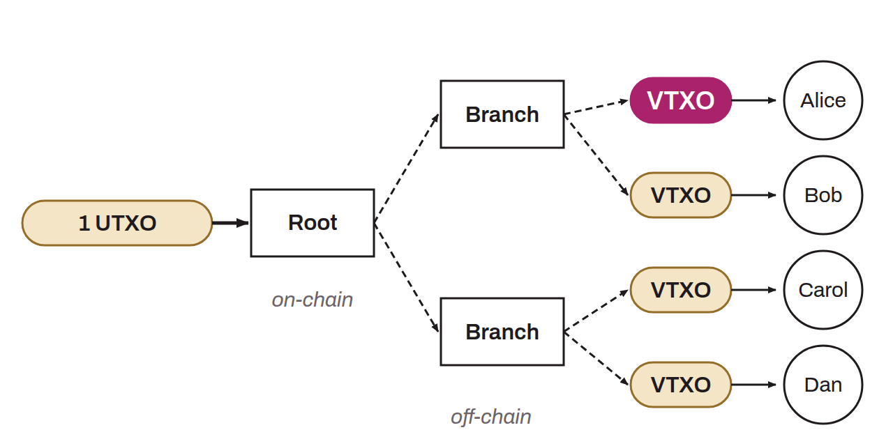

Acronym for *Virtual Transaction Output*. A VTXO is a virtual portion of an on-chain Bitcoin UTXO within the Ark protocol. Rather than each owning an individual UTXO on the blockchain (costly in fees and hard to scale), several users share a single UTXO through VTXOs managed by an Ark Service Provider (ASP).

A VTXO is obtained either by depositing on-chain bitcoin to a boarding address, or by receiving it from another user of the same ASP. VTXOs are atomically connected to one another: when Alice sends a VTXO to Bob, the ASP creates an on-chain output that includes Alice's portion intended for Bob. Alice loses her funds only if Bob actually receives them. Existing VTXOs are continuously destroyed and recreated during the rounds organized by the ASP.

VTXOs have an expiration date (typically 4 weeks). The user must refresh them before the deadline, or the ASP reclaims the liquidity. At any time, the user can perform a unilateral on-chain exit to convert a VTXO into a regular UTXO, although this operation incurs transaction fees.
