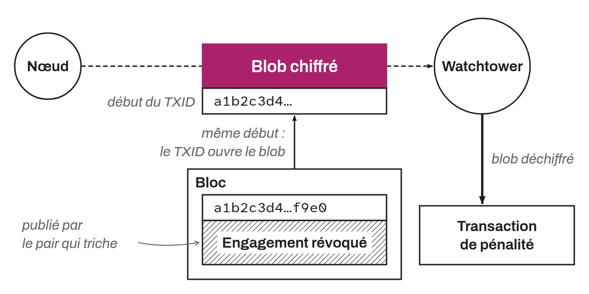

External service that monitors the Bitcoin blockchain on behalf of a Lightning node to detect any attempt to cheat the node on its channels. If a dishonest peer publishes an old commitment transaction while the node is offline, the watchtower automatically broadcasts the corresponding penalty transaction to recover all of the channel's funds before the timelock expires.

The mechanism is designed to preserve the node's privacy: at each channel update, the node encrypts the presigned penalty transaction with the txid of the relevant commitment transaction, then sends the watchtower this encrypted blob along with a truncated portion of the txid. The watchtower can decrypt the transaction only if it observes a matching txid on the blockchain (spotted through the truncated portion), that is, in case of actual cheating. It therefore has no visibility into the identity of the peers, the balances, or the structure of the channels during normal operation. It learns this information only in case of cheating.

A watchtower is a minimally trusted third party: it can neither modify nor divert the funds, since the penalty transaction is already signed with outputs fixed in favor of the channel owner. The only risk for the node is relying on a watchtower that fails to fulfill its role at the moment it is truly needed. This is why a node can configure several, to make sure that at least one of them acts correctly when needed.

Some watchtowers are called “altruistic”: they are offered publicly and free of charge, and any Lightning node can also play this role for other nodes.
