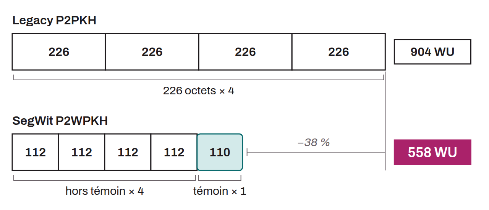

Unit of measurement introduced by SegWit (BIP-0141) to quantify the space a transaction or a block takes up relative to the maximum allowed limit. Each weight unit (WU) represents 1/4,000,000th of the maximum capacity of a block. This unit replaces the raw-byte measure used before SegWit, and makes it possible to apply differentiated weighting according to the nature of the data in a transaction.

The weight of a transaction is calculated from a distinction between non-witness data (version, inputs, outputs, locktime) and witness data (signatures, public keys, and other proof elements added by SegWit). The formula is:
$$weight\ =\ non\text{-}witness\ size \times 4\ +\ witness\ size \times 1$$

In other words, each byte of non-witness data counts for 4 WU, while each byte of witness data counts for only 1 WU. For a legacy transaction (without SegWit), there is no witness data, so the weight is simply 4 times the size in bytes. For example, a standard legacy P2PKH transaction of 226 bytes weighs $226 \times 4 = 904$ WU.

For an equivalent SegWit transaction (P2WPKH, 1 input, 2 outputs), the total size is about 223 bytes, including about 110 bytes of witness (signature and public key). The weight is then:
$$113 \times 4 + 110 \times 1 = 452 + 110 = 562\ WU$$

This represents a reduction of about 38% compared with the equivalent legacy transaction, which makes it possible to include more transactions in a block.

The block limit is set at 4,000,000 WU. If a block contains only legacy transactions, this limit is equivalent to the old limit of 1,000,000 bytes ($1{,}000{,}000 \times 4 = 4{,}000{,}000$), which ensures backward compatibility with nodes that have not upgraded. In practice, with a majority of SegWit transactions, blocks reach about 2 to 3 MB in actual size. The theoretical maximum approaches 4 MB, but only in the pathological case of a block filled almost exclusively with witness data.

To convert a weight into virtual bytes (vbytes), simply divide by 4: $vbytes\ =\ weight\ /\ 4$. Transaction fees are generally expressed in sat/vB (satoshis per vbyte).
