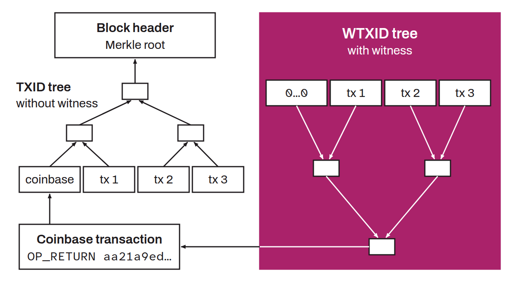

Extension of the traditional TXID that includes the witness data introduced with SegWit. While the TXID is a hash of the transaction data excluding the witness, the WTXID is the `SHA256d` of all of the transaction data, witness included. WTXIDs are stored in a second Merkle tree whose root is placed in the coinbase transaction. This separation eliminates the malleability of the transaction's TXID.

