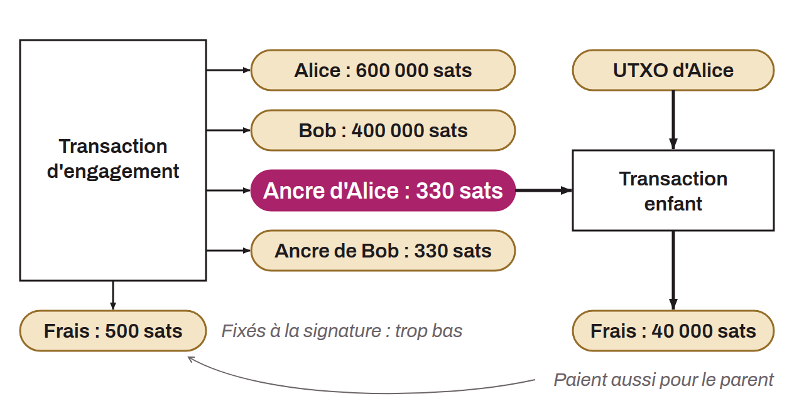

Mécanisme, intégré aux BOLT sous le nom `option_anchors` (BOLT-03), qui améliore la gestion des frais de transaction dans le cadre des canaux Lightning. À chaque changement d'état dans un canal Lightning, les parties prenantes créent et signent une nouvelle transaction d'engagement qui reflète la nouvelle répartition des fonds au sein du canal. Le problème de ce mécanisme réside dans la détermination des frais de transaction au moment de sa création. En effet, les frais de transaction sur le réseau Bitcoin sont sujets à de fortes fluctuations, tant à la hausse qu'à la baisse. Si les frais fixés pour la dernière transaction d'engagement sont insuffisants au moment de la fermeture unilatérale du canal, non seulement la transaction prendra un temps considérable à se confirmer, mais les mécanismes de verrouillage temporel (*timelocks*) pourraient également permettre un vol des fonds. Avec les *anchor outputs*, chaque transaction d'engagement contient deux petites sorties supplémentaires de 330 sats, une pour chaque partie, que seule la partie concernée peut dépenser au début (chacune est verrouillée à sa clé de financement ; n'importe qui peut balayer une ancre restée inutilisée 16 blocs après la confirmation). En cas de congestion du réseau et d'augmentation des frais, la partie qui ferme le canal dépense son *anchor output* dans une transaction enfant à frais élevés : c'est un CPFP (*Child-Pays-For-Parent*), qui fait confirmer la transaction d'engagement après coup, garantissant ainsi une fermeture suffisamment rapide du canal Lightning. Les 330 sats de chaque ancre sont prélevés sur le solde du financeur du canal.

