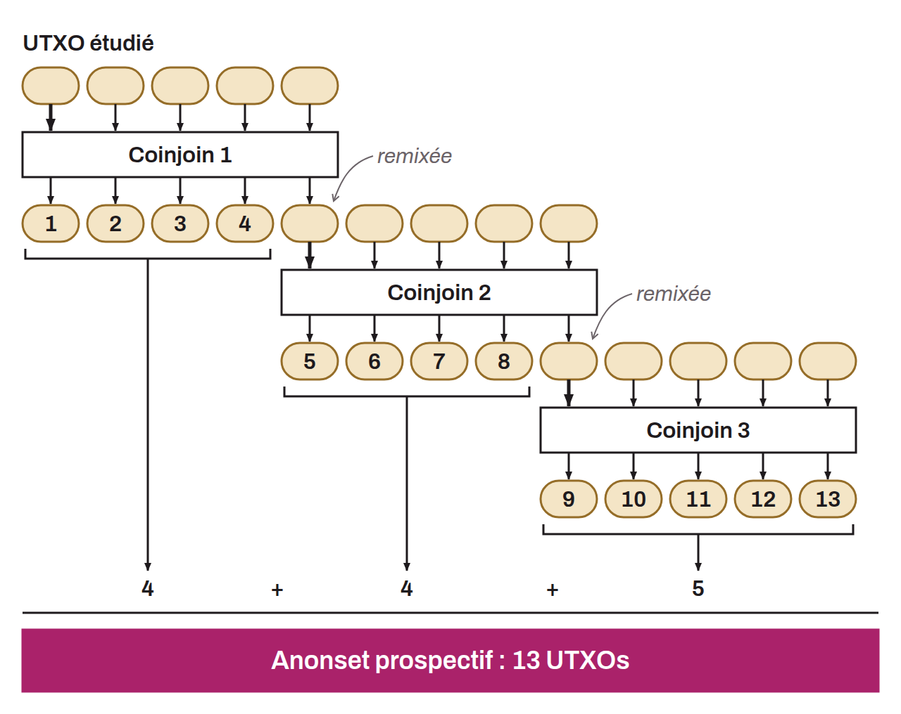
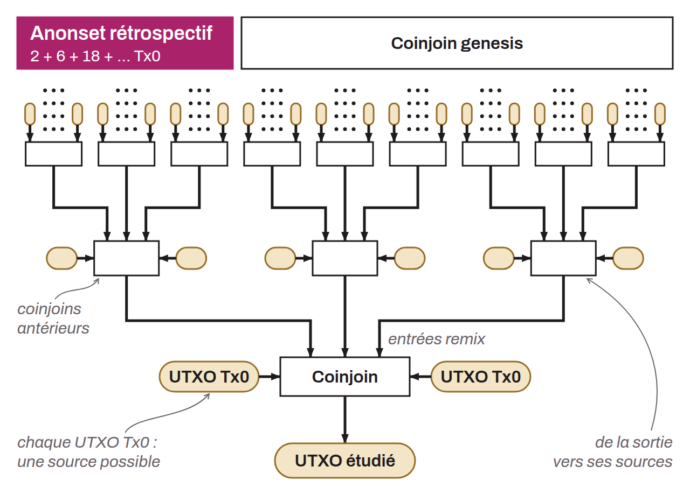

Les anonsets servent d'indicateurs pour évaluer le degré de confidentialité d'un UTXO particulier. Plus spécifiquement, ils mesurent le nombre d'UTXOs indistinguables au sein de l'ensemble qui inclut la pièce étudiée. Puisqu'il faut disposer d'un groupe d'UTXOs identiques, les anonsets sont généralement calculés au sein d'un cycle de coinjoins. Ils permettent, le cas échéant, de juger de la qualité des coinjoins. Un anonset de grande taille signifie un niveau d'anonymat accru, car il devient difficile de distinguer un UTXO spécifique au sein de l'ensemble. Deux types d'anonsets existent :
* L'ensemble d'anonymat prospectif ;
* L'ensemble d'anonymat rétrospectif.

Le premier indique la taille du groupe parmi lequel se cache l'UTXO étudié en sortie, sachant l'UTXO en entrée. Cet indicateur permet de mesurer la résistance de la confidentialité de la pièce face à une analyse passé vers présent (entrée vers sortie). En anglais, le nom de cet indicateur est « *forward anonset* », ou « *forward-looking metrics* ».

Le second indique le nombre de sources possibles pour une pièce donnée, sachant l'UTXO en sortie. Cet indicateur permet de mesurer la résistance de la confidentialité de la pièce face à une analyse présent vers passé (sortie vers entrée). En anglais, le nom de cet indicateur est « *backward anonset* », ou « *backward-looking metrics* ».

*En français, il est globalement admis d'utiliser le terme « anonset ». On pourrait toutefois le traduire par « ensemble d'anonymat » ou « potentiel d'anonymat ». En anglais et en français, on parle également parfois de « score » pour évoquer les anonsets (score prospectif et score rétrospectif).*
