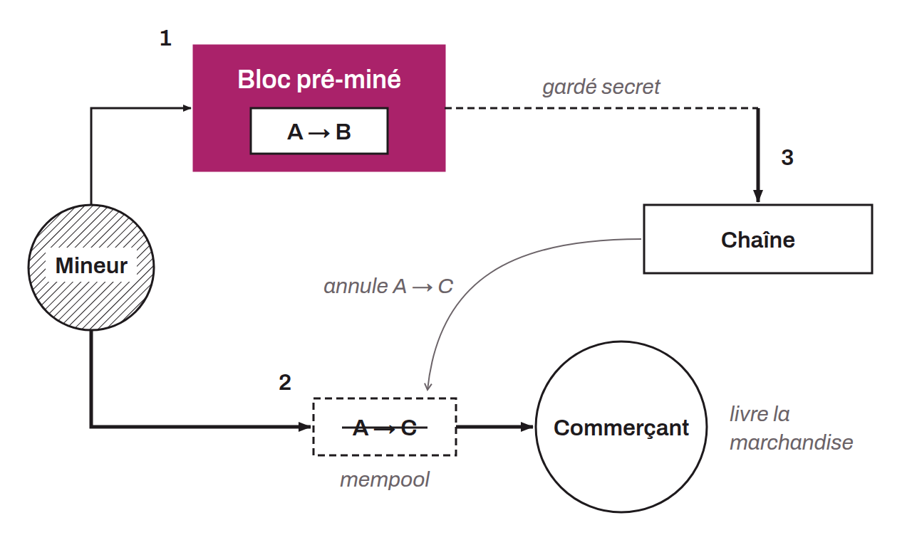

Type de double dépense qui cible les transactions à zéro confirmation. L'attaquant, qui doit être mineur, pré-mine un bloc qui contient une transaction de son adresse A vers une autre adresse B qu'il contrôle également. Au lieu de diffuser ce bloc, il effectue un paiement depuis cette même adresse A vers l'adresse C d'un commerçant. Le commerçant voit la transaction dans le mempool, ne détecte aucun conflit et livre la marchandise. L'attaquant diffuse alors son bloc pré-miné : la transaction vers B est confirmée, tandis que le paiement vers C est invalidé.

Hal Finney a décrit cette attaque en 2011 sur le forum BitcoinTalk. Elle se distingue de l'attaque des 51 % car elle ne nécessite pas une puissance de calcul majoritaire : il suffit que l'attaquant trouve un bloc, même avec un hashrate modeste. En contrepartie, sa fenêtre d'exécution est étroite et elle ne fonctionne que contre les commerçants qui acceptent des paiements sans attendre de confirmation.
