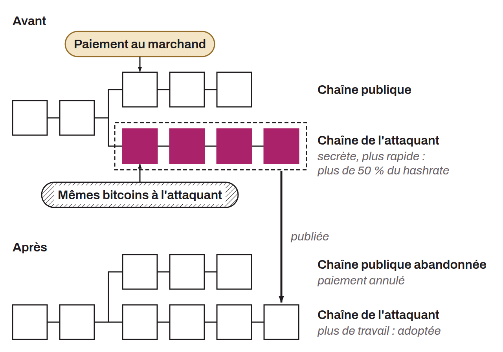

Scénario hypothétique sur le système Bitcoin où un acteur malveillant contrôle plus de 50 % de la puissance de calcul totale du minage (*hashrate*). Avec une telle dominance, l'attaquant peut manipuler le processus de consensus, permettant des actions malveillantes telles que la double dépense, où les mêmes bitcoins sont dépensés une première fois sur une chaîne finalement rendue désuète, puis une seconde fois sur la chaîne valide. Une autre finalité d'une attaque des 51 % est la censure des transactions. Cependant, réaliser une attaque des 51 % nécessite des ressources financières, humaines, énergétiques et techniques considérables, et rend l'acteur malveillant susceptible d'être découvert avant que l'attaque n'ait lieu. Bien que théoriquement possible, une attaque des 51 % sur Bitcoin est considérée comme très peu probable en raison de la décentralisation du minage et de la grande puissance de calcul déployée en 2026.

*Lorsqu'un attaquant la mène pour détruire la valeur de Bitcoin, par exemple pour un motif politique ou pour tirer profit d'une position vendeuse, plutôt que pour dépenser deux fois, on parle d'« attaque Goldfinger » (terme proposé par Kroll, Davey et Felten en 2013).*
